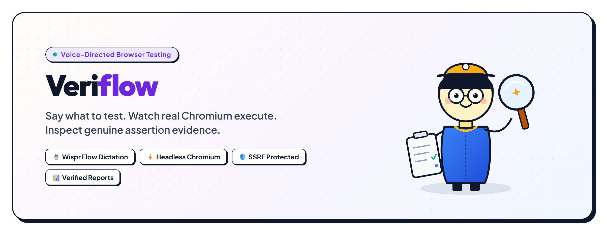

# Veriflow — Universal Voice-Directed Browser Testing Platform

<div align="center">

[](https://opensource.org/licenses/MIT)


<br/>

**Say what to test. Watch real Chromium execute. Inspect genuine evidence.**  
*A voice-directed, honest browser automation platform for arbitrary public websites and internal fixtures.*

<br/>



</div>

---

## 📑 Table of Contents
- [🌟 Project Overview](#-project-overview)
- [⚙️ Core Architecture](#️-core-architecture)
- [✅ What IS Happening (Capabilities)](#-what-is-happening-capabilities)
- [🚫 What is NOT Happening (Honesty & Anti-Hype Boundaries)](#-what-is-not-happening-honesty--anti-hype-boundaries)
- [🛡️ Security & SSRF Protection](#️-security--ssrf-protection)
- [🧪 How to Test: Step-by-Step Guide](#-how-to-test-step-by-step-guide)
  - [1. Prerequisites & Installation](#1-prerequisites--installation)
  - [2. Running Locally (Development Mode)](#2-running-locally-development-mode)
  - [3. Running Unified Production Mode](#3-running-unified-production-mode)
  - [4. Running via Docker Container](#4-running-via-docker-container)
  - [5. Testing Public Websites (e.g., WeMakeDevs, Hacker News)](#5-testing-public-websites-eg-wemakedevs-hacker-news)
  - [6. Testing the Internal Demo Store & Bug Injection](#6-testing-the-internal-demo-store--bug-injection)
  - [7. Running the Automated Playwright Suite](#7-running-the-automated-playwright-suite)
- [🚀 24/7 Cloud Deployment for Judges](#-247-cloud-deployment-for-judges)
- [🔮 Future Scope & Roadmap](#-future-scope--roadmap)
- [📄 License](#-license)

---

## 🌟 Project Overview

**Veriflow** solves a critical problem in modern software delivery: *AI can build web apps faster than ever, but proving that critical flows actually work in a real browser still requires tedious script writing and manual testing.*

With Veriflow, engineers and QA teams can:
1. **Dictate or type testing scenarios** in plain English (powered by **Wispr Flow** desktop voice dictation or the interactive command console).
2. **Review a structured, transparent test plan** before a single click occurs.
3. **Observe real headless Chromium execution** with milestone viewport previews streamed in real-time.
4. **Inspect genuine evidence**: DOM assertion pass/fails, execution durations, console and network errors, and failure diffs.
5. **Export certified audit reports** in structured JSON and human-readable Markdown with a single click.

Meet **Veri** — our friendly QA Scout mascot! Veri accompanies engineers through every stage of testing: listening to voice dictation, inspecting DOM trees with her magnifying glass, observing live milestone screens, and stamping verified approvals on test reports.

---

## ⚙️ Core Architecture

Veriflow is built as a **unified, full-stack testing platform**:

```text
┌────────────────────────────────────────────────────────────────────────┐
│                        Frontend UI (React 18 + Vite)                   │
│   • TargetUrlInput (Public URLs & Presets)  • CommandBar (Wispr Flow)  │
│   • PlanReviewBox (Transparent Steps)       • BrowserPreview (Frames)  │
│   • RunTimeline (Step Events)               • EvidencePanel (Diffs)    │
│   • DemoStorePage (/demo-store Fixture)     • ReportExport (JSON / MD) │
└───────────────────────────────────┬────────────────────────────────────┘
                                    │ HTTP / JSON
┌───────────────────────────────────▼────────────────────────────────────┐
│                  Unified Express API Server (Node.js)                  │
│   • /api/validate-url  • /api/plan  • /api/runs  • /api/runs/:id/preview│
│   • /api/demo/config   • /api/demo/reset         • /artifacts/*        │
│   • Static Frontend Servicing (dist/ + SPA Catch-All Route)            │
└─────────────────┬──────────────────────────────────┬───────────────────┘
                  │                                  │
┌─────────────────▼──────────────┐   ┌───────────────▼───────────────────┐
│  SSRF & Destination Guardrails │   │     Natural Language Planner      │
│  • RFC 1918 Private IP Shield  │   │  • Deterministic Intent Grammar   │
│  • Cloud Metadata Host Blocking│   │  • 7 Universal Command Handlers   │
│  • DNS Rebinding Interceptor   │   │  • Action & Assertion Synthesis   │
│  • Protocol & Port Policy      │   │  • Destructive Action Warnings    │
└─────────────────┬──────────────┘   └───────────────┬───────────────────┘
                  │                                  │
┌─────────────────▼──────────────────────────────────▼───────────────────┐
│                   Playwright Automation Engine                         │
│  • Isolated Headless Chromium Process (Separate Context per Run)       │
│  • Bounded Timeouts: Navigation 20s, Actions 8s                        │
│  • Real Milestone Viewport Captures -> /runs/:runId/artifacts/         │
│  • Real Web-First Assertions: title, heading, navbar, visible, text    │
└────────────────────────────────────────────────────────────────────────┘
```

---

## ✅ What IS Happening (Capabilities)

- **Honest Chromium Browser Automation**: Every test actually launches an isolated Chromium browser instance on the server. Navigations, element clicks, form fills, and scrolls are real browser events executed against the target DOM.
- **Voice-Directed Testing via Wispr Flow**: Dictate instructions directly into the command bar using Wispr Flow. Veriflow parses spoken phrases into structured browser actions and assertions without requiring cloud API keys.
- **7 Universal Testing Presets**:
  - `CMD-TITLE`: Verifies document `<title>` matches brand expectations.
  - `CMD-HEADING`: Checks presence, count, and hierarchy of `<h1>` tags.
  - `CMD-NAV`: Asserts accessibility of navigation landmarks (`<nav>`, `role="navigation"`).
  - `CMD-SEARCH`: Finds search inputs and exercises query flows.
  - `CMD-CONSOLE`: Audits uncaught JavaScript exceptions and failed HTTP responses.
  - `CMD-RESPONSIVE`: Tests viewports across Mobile (375x667), Tablet (768x1024), and Desktop (1280x720).
  - `CMD-LINK`: Audits anchor tags and flags broken links / missing hrefs.
- **Dual-Mode Target Flexibility**:
  - **Arbitrary Public Websites**: Test any live site on the open internet (e.g., `https://www.wemakedevs.org`, `https://example.com`, `https://news.ycombinator.com`).
  - **Internal Demo Fixture (`/demo-store`)**: An accessible e-commerce storefront with cart, checkout, out-of-stock guards, and live defect injection.
- **Real-Time Milestone Viewport Previews**: Playwright captures genuine PNG screenshots at critical milestones (navigation, interaction, assertion). The UI displays these timestamped frames alongside active step indicators.
- **Live Defect Injection & Verified Recovery**: Inject labeled bugs (`bugCartTotalWrong`, `bugInvalidEmailAccepted`) to produce reproducible Playwright assertion failures, then disable the bug and dictate *"Rerun failed tests"* to prove green recovery.
- **Certified Report Export**: Instantly download complete run reports in both machine-readable `.json` and human-readable `.md` formats.

---

## 🚫 What is NOT Happening (Honesty & Anti-Hype Boundaries)

In accordance with strict hackathon and engineering honesty standards:

- ❌ **NO Mock or Hardcoded Test Results**: Veriflow never displays a fake "PASS" or "FAIL". Statuses and durations are parsed directly from Playwright's JSON reporter and browser assertion evaluations.
- ❌ **NO Fake Live Video Streams**: We never loop an MP4 or pretend a static GIF is a live video feed. Preview frames are explicitly labeled as *honest milestone viewport captures*.
- ❌ **NO Raw Shell or Unchecked Code Execution**: Natural language commands are never passed to `eval()`, `child_process.exec()`, or raw shell strings. All intents are parsed through deterministic allowlists and structured schemas.
- ❌ **NO Paywall, CAPTCHA, or Auth Bypass**: Veriflow does not attempt credential cracking, bot-detection circumvention, or unauthorized access to password-protected private platforms.
- ❌ **NO Autonomous Code "Self-Repair" Claims**: We do not claim to automatically rewrite your application's source code when a test fails; Veriflow provides transparent evidence diffs and failure screenshots so engineers can fix root causes.
- ❌ **NO Unbounded Crawlers or DoS Risks**: Execution concurrency is strictly controlled. An active run must finish before a new one can execute, preventing server resource exhaustion.

---

## 🛡️ Security & SSRF Protection

Because Veriflow accepts arbitrary target URLs, it features a multi-layered security shield ([`server/urlSecurity.ts`](server/urlSecurity.ts)):

1. **Protocol Restriction**: Only `https:` and `http:` schemes are permitted. Malicious schemes (`file:`, `javascript:`, `data:`, `gopher:`, `ftp:`) are rejected immediately before browser invocation.
2. **Private Network (SSRF) Defense**: Prohibits requests to RFC 1918 private subnets (`10.0.0.0/8`, `172.16.0.0/12`, `192.168.0.0/16`), loopback (`127.0.0.1`, `::1`), link-local (`169.254.0.0/16`), and carrier-grade NAT ranges.
3. **Cloud Metadata Defense**: Hardcoded blocks against AWS/GCP/Azure metadata hosts (`169.254.169.254`, `metadata.google.internal`, `instance-data`).
4. **DNS Rebinding Defense**: Resolves target hostnames prior to execution and inspects all resolved IP addresses against blacklisted ranges.
5. **Credential Stripping**: Automatically strips embedded HTTP authentication (`user:pass@host`) from target URLs and warns the user.
6. **Port Whitelist**: External public testing is restricted to standard web ports (`80`, `443`, `8080`, `8443`).

---

## 🧪 How to Test: Step-by-Step Guide

### 1. Prerequisites & Installation

- **Node.js**: v20 or higher
- **npm**: v9 or higher
- **Git**

```bash
# Clone the repository
git clone https://github.com/vaibhavvvvjain03/VERIFLOW.git
cd VERIFLOW

# Install dependencies
npm install

# Install Playwright browser dependencies (Chromium)
npx playwright install --with-deps chromium
```

---

### 2. Running Locally (Development Mode)

In development, you run the Vite frontend and Express server concurrently:

```bash
# Terminal 1: Start the Express backend API and runner (Port 3001)
npm run server

# Terminal 2: Start the Vite frontend dev server (Port 3000)
npm run dev
```

Open your browser at **`http://localhost:3000`**. Vite proxies `/api` and `/artifacts` requests to port 3001 automatically.

---

### 3. Running Unified Production Mode

You can run the entire platform as a single unified service on one port:

```bash
# 1. Build the production React frontend bundle
npm run build

# 2. Start the unified production server
npm start
```

Open **`http://localhost:3000`** (or your specified `$PORT`). The Express server serves both the static frontend and the Playwright API.

---

### 4. Running via Docker Container

The repository includes a production Dockerfile based on Microsoft's official Playwright noble image:

```bash
# Build the Docker image
docker build -t veriflow .

# Run the container
docker run -p 3000:3000 veriflow
```

Visit **`http://localhost:3000`** in your browser.

---

### 5. Testing Public Websites (e.g., WeMakeDevs, Hacker News)

1. Open the Veriflow Workspace at `/workspace`.
2. In the **Target Website URL** field, choose a preset (e.g., `WeMakeDevs` or `Hacker News`) or type any custom public URL (e.g., `https://www.wemakedevs.org`).
3. Click one of the **Universal Commands** (e.g., **`CMD-NAV`** or **`CMD-HEADING`**), or type:
   > *"Check if navigation bar is visible and verify all header buttons"*
4. A **Structured Test Plan Review Box** will appear showing each step (Action vs Assertion).
5. Click **Confirm & Run Plan**.
6. Watch Playwright launch Chromium, navigate to the target site, and stream milestone frames into the **Honest Execution Preview**.
7. Inspect the **Run Timeline** and **Evidence Panel** for response status codes, console error tallies, and element checks.
8. Click **Export Report** to download the certified Markdown audit.

---

### 6. Testing the Internal Demo Store & Bug Injection

1. Set the Target URL to `http://localhost:3000/demo-store` (enable the *Allow Local Fixture* toggle).
2. Type or dictate: *"Run all tests"*.
3. All six tests (`T01`–`T06`) run in isolated Chromium sessions and turn **green (PASS)**.
4. Navigate to `/demo-store` and toggle the labeled demo defect:
   - Check **Inject Bug: Wrong Cart Subtotal (`BUG_CART_TOTAL_WRONG`)**.
5. Return to `/workspace` and dictate: *"Run the cart total test"*.
6. Watch `T02` **fail deterministically**:
   - The Evidence Panel highlights the assertion mismatch: `Expected $118, received incorrect subtotal`.
   - The failure screenshot artifact is displayed.
7. Return to `/demo-store`, uncheck the defect toggle, and dictate: *"Rerun failed tests"*.
8. Veriflow submits *only* `T02`, which now passes with verified green proof!

---

### 7. Running the Automated Playwright Suite

To execute the automated end-to-end regression suite via terminal:

```bash
# Run headless Playwright regression tests
npm run test:e2e

# Run with interactive Playwright UI
npm run test:e2e:ui
```

---

## 🚀 24/7 Cloud Deployment for Judges

For complete deployment instructions, see [**`DEPLOYMENT.md`**](DEPLOYMENT.md).

### One-Click Deployment to Railway (~2 Minutes)
1. Go to [railway.app](https://railway.app) and sign in with GitHub.
2. Click **+ New Project** ➔ **Deploy from GitHub repo** ➔ Select `vaibhavvvvjain03/VERIFLOW`.
3. Railway automatically detects [`Dockerfile`](Dockerfile) and [`railway.json`](railway.json).
4. In **Settings** ➔ **Networking**, click **Generate Domain**.
5. Share your permanent `https://veriflow-production.up.railway.app` URL with judges!

---

## 🔮 Future Scope & Roadmap

- [ ] **Multi-Tab & Cross-Origin Session Testing**: Support testing SSO redirects, OAuth popups, and multi-tab workflows.
- [ ] **Perceptual Visual Regression Diffing**: Pixel-by-pixel visual diffing with configurable tolerance thresholds to detect subtle CSS regressions.
- [ ] **Self-Healing Selectors**: Intelligent fallback locators that dynamically recover when developers update CSS class names or DOM structures.
- [ ] **CI/CD GitHub Actions Integration**: Automated bot that posts visual evidence summaries and test reports directly to pull requests.
- [ ] **Multi-Browser Matrix**: Extend dynamic execution from Chromium to headless Firefox and WebKit (Safari).
- [ ] **Audio Speech Feedback**: Interactive voice confirmations (text-to-speech) confirming when test runs start and report verdicts.

---

## 📄 License

This project is licensed under the **MIT License** — see the [LICENSE](LICENSE) file for details.

---

<div align="center">
  <sub>Built with craftsmanship for reliable browser testing. Powered by Playwright, React, Express, and Wispr Flow.</sub>
</div>
